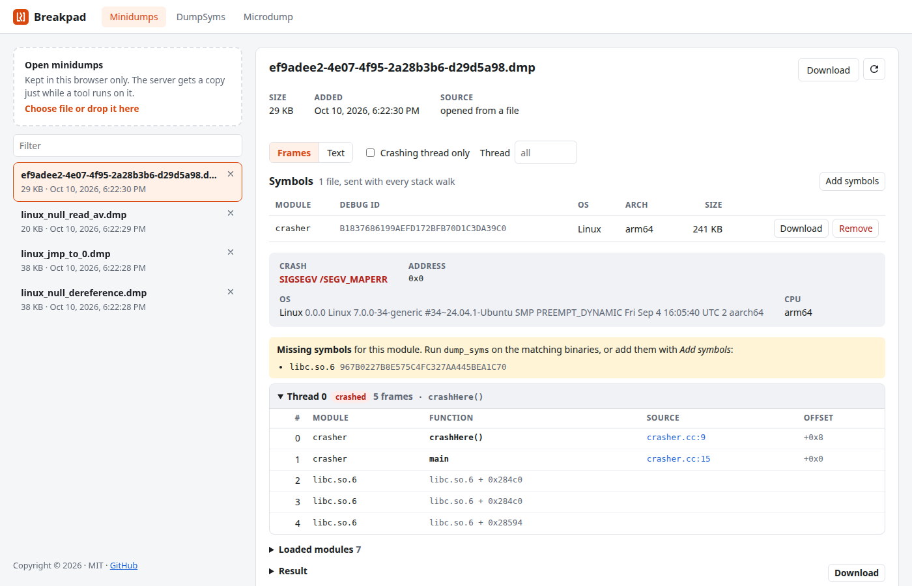

# Breakpad

A web page and service for working with [Breakpad](https://chromium.googlesource.com/breakpad/breakpad)
minidumps. It is a libnetq WLA module (`breakpad_wla`) that runs the Breakpad
tools built next to it, plus a React page that drives it.

**The server keeps no user files.** Minidumps, their symbol files and their
last stack walk are stored only in the user's browser (IndexedDB). Each
minidump has its own list of symbol files, and a stack walk sends the `.dmp`
and all of them together, in one request. The server lays the files out in a
scratch directory for the tool and deletes it when the request ends.



What the page covers, and the tool behind each part:

| Page | Tool | What you can do |
| --- | --- | --- |
| Minidumps | `minidump_stackwalk` | Open dumps (kept in the browser) and read symbolized stack traces: frames table or plain text, crashing thread only, one thread, stack contents, brief output, pointers on the stack. The last walk is kept, so opening a dump shows it without asking the server |
| | `dump_syms` | Add symbol files to a dump: Breakpad `.sym` files as they are, or ELF files turned into `.sym` files on the server. A notice lists the modules that still have none |
| DumpSyms | `dump_syms` | Get the symbols of an ELF file (plus its separate debug file, if split off) to preview, download, or add to a minidump in the browser |
| Microdump | `microdump_stackwalk` | Paste or upload Android logcat output and walk the microdump in it, with symbol files added just for that walk |

Because the server keeps nothing, crash reporters (`minidump_upload`, Crashpad)
and `sym_upload` cannot send files to it. Users add dumps and symbols on the
page instead.

## Building

The whole tree, including Breakpad and libnetq, builds with bitmake into `build/package`:

```bash
npx bitmake build
cd /some/work/dir && /path/to/build/package/bin/breakpad_server   # http://localhost:8033/
```

The `bundle:output` step is a regular CMake project. Its library target runs
`npm install` and `npm run build`, so the page in `dist/` is rebuilt whenever
anything under `src/`, `public/` or `tools/` changes. Installing puts the module
and the server in `bin/`, next to the Breakpad tools, and the page in
`share/breakpad-wla/`.

| CMake option | Default | |
| --- | --- | --- |
| `BREAKPAD_BASE_URL` | `/` | URL prefix the page and API are served under |
| `BREAKPAD_TOOLS_DIR` | empty | Absolute directory all the Breakpad tools are run from; empty means the directory `breakpad_wla.so` is loaded from |
| `BREAKPAD_DATA_DIR` | empty | Absolute data directory; empty means `breakpad-data/` in the server's working directory |
| `BREAKPAD_INSTALL_SERVER` / `_MODULE` / `_ASSETS` | `ON` | What `install` copies |

### Where things live at run time

- **Tools:** `BREAKPAD_TOOLS_DIR` if the module was built with it, otherwise
  the directory `breakpad_wla.so` was loaded from.
- **Page:** `share/breakpad-wla/`, next to that directory. The module serves
  the files `manifest.json` lists there.
- **Scratch space:** `tmp/` under the `BREAKPAD_DATA_DIR` the module was built
  with, or under `breakpad-data/` in the server's working directory. Each
  request gets its own directory there, removed when the request ends; `tmp/`
  is deleted on start, so the data directory must belong to this service alone.
  Nothing else is written. Both directories are created by the first request
  that stores a file, so they belong to the user that handles requests
  (Apache's workers as `daemon`, say), even when the server starts as root.

```
breakpad-data/tmp/job-XXXXXX/
  part-N/<file>                         uploaded files (dump, .sym files, …)
  symbols/<module>/<id>/<module>.sym    the request's symbol files, in the layout
                                        the stackwalk tools read
```

A `.pdb` module's file is laid out as `<name without .pdb>.sym`, the same name
the tools look for.

## Developing the page

```bash
npm install
breakpad_server &          # the API, on :8033
npm run dev                # Vite with hot reload; the API routes are proxied to :8033
```

Set `BREAKPAD_SERVER=http://host:port` to proxy somewhere else. `npm run build`
typechecks and writes `dist/`. Every npm script takes `--base-url=/prefix`,
which must match `BREAKPAD_BASE_URL` (see [tools/base-url.js](tools/base-url.js)).

Pages are addressed by the URL hash (`#/minidumps/<id>`, `#/dumpsyms`,
`#/microdump`). The server only ever serves `index.html` at the base URL, and
a reload keeps the current page. The title in the header links to the page
itself, at the same URL as the manifest entry's `main`. Below the site root
(`/prefix`), the header also has a Home link back to the site's home page.

`dist/manifest.json` lists the build's base URL, its entry page and every file
with the URL it is served from; `index.html` is listed at the base URL itself.
The entry gives `favicon.svg` as its icon and `logo_wla.svg` as its screenshot,
the card that presents the page on the site's main page. Both are set in
`vite.config.ts`.

## API

All paths are below the base URL; they are `kRoutes` in `module.c` and
`API_PATHS` in `vite.config.ts`. Responses are JSON unless they are file
downloads. Errors are `{"error": "..."}`. When a tool ran and failed, the error
response also carries the tool's `result` and has status 422.

A tool `result` is:

```json
{
  "command": "/…/minidump_stackwalk -f human /…/minidump.dmp /…/symbols",
  "ok": true, "exitCode": 0, "signal": null, "timedOut": false, "durationMs": 12,
  "stdout": "…", "stdoutTruncated": false,
  "stderr": "…", "stderrTruncated": false
}
```

A non-zero exit is still a 200 response for the stack walks: the tools can
exit non-zero on dumps they otherwise handle, and their output is still worth
reading.

| Method and path | Body | Result |
| --- | --- | --- |
| `POST minidump_stackwalk` | multipart: file `minidump`, `symbols` files, `options` `{format: "human"\|"machine", crashOnly, brief, stack, dumpPointers, thread}` | `{result}` |
| `POST dump_syms` | multipart: ELF file `binary`, optional separate debug file `debug`, `options` `{cfi, inline, headerOnly, noCrossCu, preserveLoadAddress, multiple, verbose, id, name, os}` | The `.sym` file |
| `POST microdump_stackwalk` | multipart (`microdump` file or text field, `machine`, `stack`, `symbols` files), JSON `{microdump, machine, stack}`, or the raw log | `{result}` |

`options` is a text field holding a JSON object, and may be omitted. The
minidump may also be sent as the raw request body. `symbols` means any number
of file parts with that name, each one a Breakpad `.sym` file; each is placed
by its `MODULE` line, and a part that is not a symbol file is rejected with
400. A module without a symbol file is still walked, just without names or
line numbers.

The server keeps nothing from any request: the uploaded files, and anything a
tool writes, are deleted when the request ends. Generated symbol files are
sent back as downloads, and the page keeps them in the browser.

Uploaded files are streamed to disk as they arrive, so large uploads stay out of
memory. A request body is limited to 512 MB, a text field to 8 MB and a JSON
body to 1 MB. No endpoint reads the query string: options always travel in the
body.

## Things to know

- **No authentication.** Anyone who can reach `breakpad_server` (port 8033,
  set in `server.c`) can run the tools on files they send. Keep it on a
  trusted network.
- **Browser storage is per browser and per site.** Minidumps and symbol files
  added in one browser are not visible in another, and they are gone when the
  site's data is cleared. The page asks the browser to keep the storage
  persistent, but the user can still clear it. Download files to keep a copy.
- **Symbol files belong to one minidump.** They are deleted with it, and a
  second dump of the same program needs them added again. The Microdump page
  keeps its symbol files only while it is open.
- **Each stack walk uploads the dump and its symbols again.** Changing stack
  trace options and running again sends everything afresh. For large modules
  (a browser's libxul or Chromium: hundreds of MB of symbols) that makes every
  walk slow.
- **Tool limits.** Each tool run has a 5 minute timeout. Captured output is cut
  at 64 MB (stdout) and 4 MB (stderr).

## Layout

```
server.c                breakpad_server: loads the module on :8033
module.c                the WLA module: page files from manifest.json, API routes
BreakpadTool.c          runs a tool (posix_spawn, captured output, timeout)
BreakpadStore.c         per-request scratch directories and the symbol file layout
BreakpadBody.c          request bodies: multipart / JSON / raw, streamed to disk
index.html, src/        the page (React + TypeScript)
  api.ts                typed API client
  base.ts               the base URL the page is served under
  db.ts                 the browser database (IndexedDB)
  minidumpStore.ts      minidumps kept in the browser
  dumpSymbolStore.ts    each minidump's symbol files
  symbolFile.ts         reading a .sym file's MODULE line
  stackwalkCache.ts     each minidump's last stack walk
  stackwalk.ts          parser for machine-readable stackwalk output
  router.ts             hash routes
  components/           one component per page, plus StackwalkView / SymbolList / ToolOutput / DropZone
public/                 favicon and logo_wla.svg (the card on the site's main page)
tools/
  manifest-plugin.ts    writes dist/manifest.json, which the module serves the page from
  base-url.js           --base-url handling for vite.config.ts
bitmake.config.mjs      builds zlib, OpenSSL, CivetWeb, Jansson, Breakpad, libnetq and this project
docs/screenshot.png     the screenshot above
```
